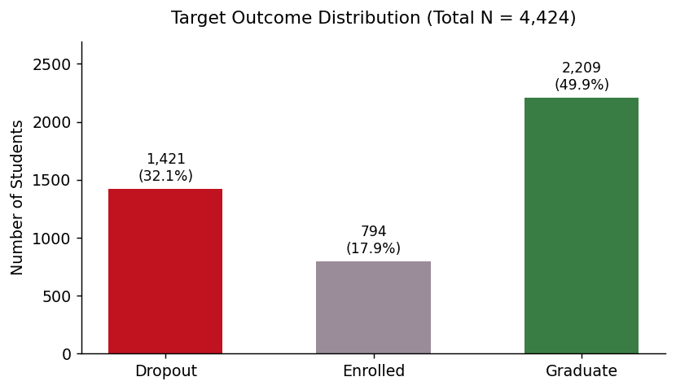
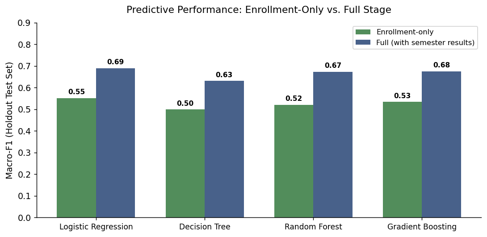
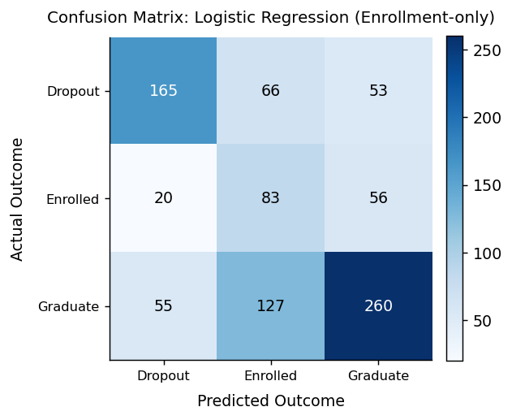
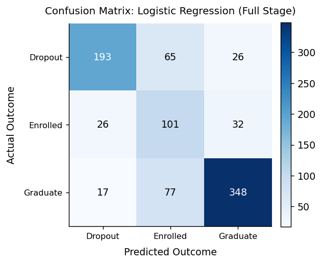
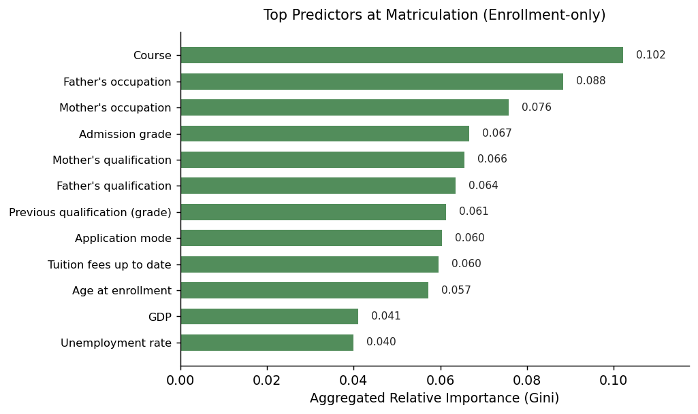
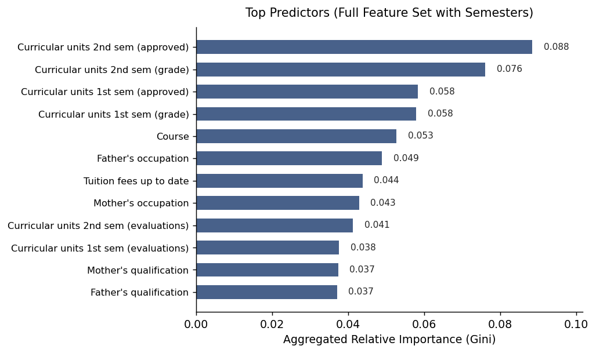

# Predict Students' Dropout and Academic Success

A three-class machine learning project that predicts a higher-education student's final outcome: **Dropout**, **Enrolled** or **Graduate**.

Every model is trained and evaluated twice:

1. **Enrollment-only** (24 features): what is known on the day a student registers, including demographics, socio-economic background, prior qualifications and admission grade. This is the realistic early-warning case.
2. **Full** (36 features): the same features plus the 12 first- and second-semester measures (units credited, enrolled, evaluated and approved, grades, and units without evaluation).

Keeping the stages apart shows how much of the predictive power comes from semester results. It also stops those results from leaking into the early prediction.

## Dataset

UCI Machine Learning Repository, [Predict Students' Dropout and Academic Success](https://archive.ics.uci.edu/dataset/697/predict+students+dropout+and+academic+success): 4,424 students, 36 features, no missing values. The file is `data/data.csv` and is semicolon-separated.



The classes are uneven, so the headline metric is **macro-averaged F1**. It weights all three classes equally, so the small Enrolled class counts as much as the others. Imbalance is handled with class weighting.

## Method

- Stratified 80/20 train/test split (random seed 42). All scores are on the held-out test set.
- One shared preprocessing pipeline, fit on the training split only. Continuous features are standardised, and the integer-coded categorical features are one-hot encoded.
- Four models:
  - **Logistic Regression**: balanced class weights.
  - **Decision Tree**: max depth 6, balanced class weights.
  - **Random Forest**: 400 trees, balanced subsample class weights.
  - **HistGradientBoosting**: 400 iterations, learning rate 0.06, max depth 6, trained with balanced sample weights.

## Results

| Model | Enrollment-only accuracy | Enrollment-only macro-F1 | Full accuracy | Full macro-F1 |
|---|---|---|---|---|
| Logistic Regression | 0.574 | **0.551** | 0.725 | **0.689** |
| Decision Tree | 0.495 | 0.499 | 0.647 | 0.630 |
| Random Forest | 0.641 | 0.521 | **0.764** | 0.672 |
| Gradient Boosting | 0.588 | 0.534 | 0.734 | 0.675 |



- Logistic Regression has the best macro-F1 in both stages.
- Random Forest has the highest accuracy, but it recalls few Enrolled students (13% enrollment-only, 30% full), so its macro-F1 is lower.
- Adding the semester results raises macro-F1 by about 0.14 for every model.
- Enrollment-only predictions are much weaker, so they are best used to decide which students to check on, not as a verdict.

| | Enrollment-only | Full |
|---|---|---|
| Confusion matrix (best model) |  |  |
| Feature importance (Random Forest) |  |  |

## Project layout

```
data/data.csv                  dataset
src/config.py                  paths, seed, class names, feature stages
src/data.py                    loading, train/test split, preprocessing pipeline
src/models/                    one file per model + registry (src/models/__init__.py)
src/metrics.py                 accuracy, macro-F1, per-class scores, confusion matrix
src/train.py                   trains every model on both stages, saves to artifacts/
src/plots.py                   figures shared by the report script and the app
src/codebook.py                readable labels for the dataset's integer codes
scripts/generate_report_assets.py   regenerates the figures in assets/
app.py                         Streamlit dashboard and live predictor
tests/                         pytest tests
artifacts/                     trained models (compressed) + metrics.json, committed so the app loads instantly
assets/                        README figures (committed)
```

## Usage

Needs Python 3.9 to 3.12, because scikit-learn 1.3.2 has no wheels for newer versions.

```bash
git clone https://github.com/Afolabibolu/student-performance-prediction.git
cd student-performance-prediction
python -m venv .venv
source .venv/bin/activate
pip install -r requirements.txt        # or requirements-dev.txt for pytest + ruff
```

Train all models on both stages. This prints the results table and writes `artifacts/`, and takes 20 to 40 seconds. The trained models are already included in the repo, so you only need this after changing the code:

```bash
python -m src.train
```

Regenerate the README figures in `assets/`. This trains first if `artifacts/` is missing:

```bash
python scripts/generate_report_assets.py
```

Run the app. It loads the saved models from `artifacts/` (and trains them itself only if that folder is missing):

```bash
streamlit run app.py
```

The app has two pages, chosen from the sidebar:

- **Model comparison**: headline scores, then a scoreboard (results table and macro-F1 chart), confusion matrices, and feature importance.
- **Live predictor**: enter a student's details and the predicted outcome and class probabilities update as you type. It uses the enrollment-only model by default. Choose "After the first two semesters" to use the full model if you also have the semester results.

Run the tests and the linter:

```bash
pytest
ruff check .
```

## Reproducibility

The random seed is fixed at 42, and repeated runs give identical results. The scores do depend on the scikit-learn version, though: under scikit-learn 1.5 and 1.6, Random Forest scores about 0.51 macro-F1 on enrollment-only and 0.68 on full. `requirements.txt` therefore pins scikit-learn 1.3.2, which gives the numbers above.

## License

MIT, see [LICENSE](LICENSE).
